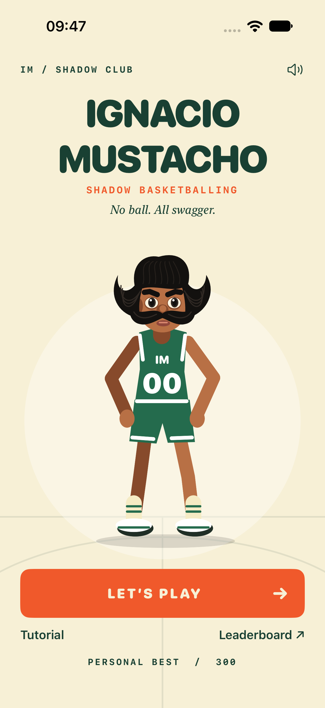
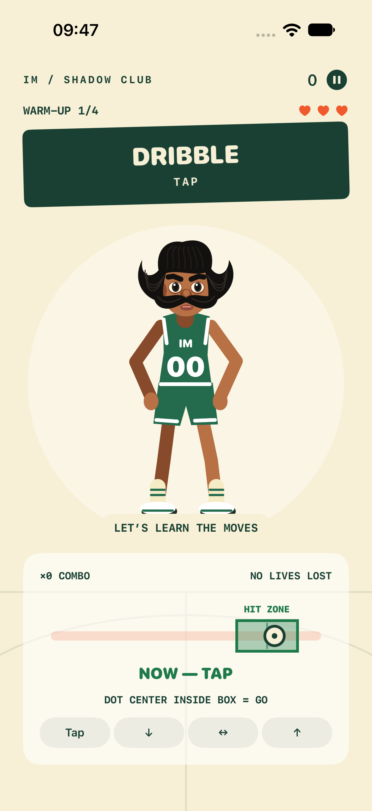

> Nota storica: per lo stato corrente vedere [ArenaUpdate](ArenaUpdate.md).

# Correzione timing e identità — 31 ottobre 2026

Feedback reale: il giocatore sentiva i comandi ma non capiva quando agire; la tolleranza ±220 ms era troppo stretta e la barra non mostrava una zona valida.

La barra ora mostra un riquadro **HIT ZONE**, verde con contorno, sopra una corsia arancio/rossa attenuata. Quando il **centro** del pallino entra nel riquadro compare **NOW — [gesto]**; prima compare **WAIT FOR THE BOX**. Il centro del pallino è marcato da un punto scuro. Il beat ideale è la linea centrale, ma tutta la fascia è valida. Il pallino prosegue oltre il beat e rende leggibile anche la tolleranza in ritardo. Dopo un gesto la scritta diventa il giudizio; non invita a ripetere un comando già risolto.

| Modalità | Good, per lato del beat | Finestra totale | Perfect, per lato |
|---|---:|---:|---:|
| Tutorial | 500 ms | 1.000 ms | 180 ms |
| Primi 8 comandi | 400 ms | 800 ms | 140 ms |
| Progressione | −20 ms ogni 8 comandi | Riduzione graduale | 140 ms |
| Dal comando 49 | 280 ms | 560 ms | 140 ms |

Il margine iniziale permette di riconoscere la zona ed eseguire uno swipe. La musica conserva la progressione precedente: 100 BPM iniziali, stessa accelerazione, stesso limite. Voce e cartelli anticipano ancora il gesto. Restano tre vite, combo, quattro mosse ed endless.

`RhythmTiming` è condiviso fra giudizio e presentazione: determina intervallo inclusivo, scadenza, posizione normalizzata del pallino e fascia valida. La vista applica a punto e bordi la medesima scala in pixel. Non esiste una seconda tolleranza hard-coded nella UI.

## Identità aggiornata

Il personaggio vettoriale segue ora il character sheet fornito dall’utente: carnagione bruna, capelli neri ondulati con frangia piena e punte laterali sollevate, sopracciglia folte, occhi grandi e baffi enormi arcuati. Eliminati ricci e fascia della prima versione. Corporatura snella, divisa originale verde/bianca e articolazioni delle quattro animazioni conservate; nessuna palla/canestro. È una **approssimazione vettoriale provvisoria**, non uno sprite fotorealistico.

Cinque immagini originali copiate in `CharacterReferences`, con fonti e hash; `Ignacio-Canonical.png` è la fonte prioritaria per evitare regressioni. Nessun credito o generatore esterno usato.

## Test

- Prima della correzione, i nuovi casi a ±350 ms in partita e ±480 ms nel tutorial fallivano con Miss: regressione riprodotta.
- Dopo la correzione: 12 test del dominio passati, inclusi bordi esatti, 1 ms fuori dai bordi, scadenza solo dopo la chiusura, corrispondenza fascia/accettazione per tutorial e 160 comandi, esclusione di un secondo input e progressione della tolleranza.
- Build iOS e **2/2 test UI passati** sulla versione finale con avatar aggiornato, iPhone 18 Pro / iOS 27.0: WAIT, NOW, tutorial/pausa/Home e tre errori/Play Again. Screenshot Home e TimingNow esportati e ispezionati: fascia, testo e figura intera leggibili. Bundle completo: `/tmp/ignacio-identity-ui.xcresult`; log `/tmp/ignacio-identity-ui.log`.
- Swift-format strict passato. SwiftLint non installato. Feeling su hardware da riconfermare dall’utente.

## Schermate della versione aggiornata

