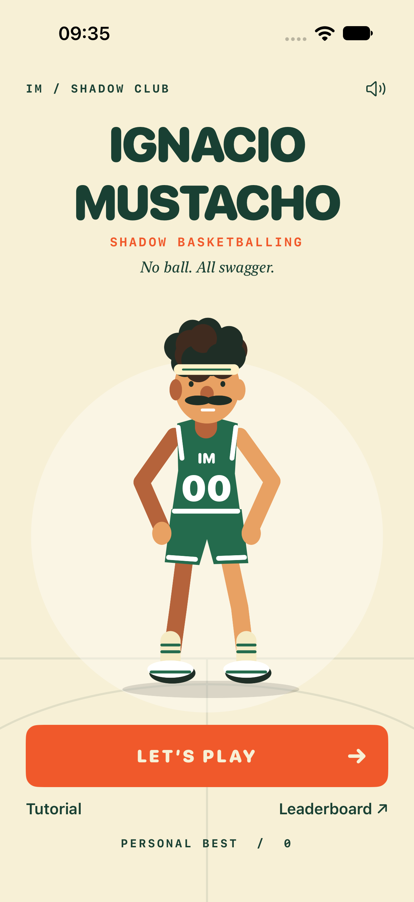
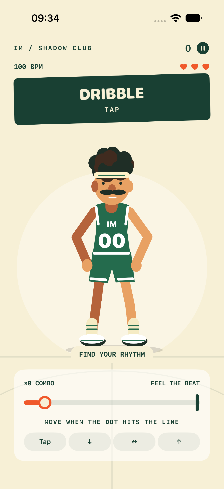
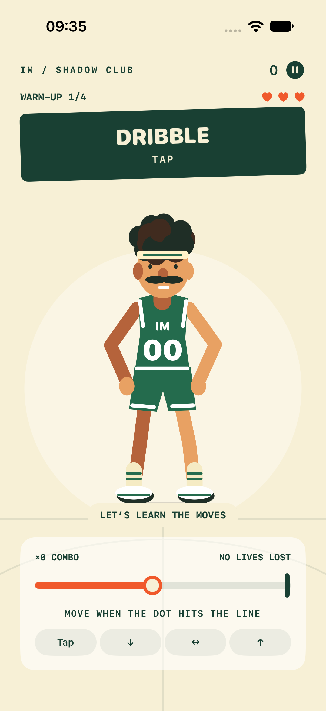
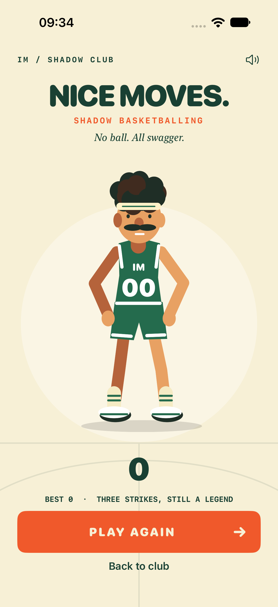

> Nota storica: per lo stato corrente vedere [ArenaUpdate](ArenaUpdate.md).

# Verifica — 31 ottobre 2026

**Aggiornamento successivo:** vedere [Timing e identità](TimingUpdate.md) per la fascia NOW, 12 test del dominio e il nuovo avatar canonico. Le schermate sotto documentano la prima versione e non sono più il riferimento visivo corrente.

- Xcode 27.0 (27A266a), Swift 6.4, scheme `Ignacio`, iPhone 18 Pro / iOS 27.0.
- Build finale **PASS**, incluse capability Game Center e risorse privacy.
- Swift Testing: **6/6 PASS**, deterministici: precisione, punti/combo, errore una sola volta, tre vite, tutorial, accelerazione e limite velocità.
- XCUITest: **2/2 PASS** (45,2 secondi di esecuzione): tutorial/pausa/Home; tutorial completo senza input, game over dopo tre mancate risposte e Play Again.
- `swift-format lint --strict`: **PASS**.
- `plutil -lint` su entitlement e manifest privacy: **PASS**.
- SwiftLint: configurato, **non eseguito** perché non installato.
- Screenshot reali esportati da XCUITest e Home/Gameplay ispezionati visivamente.
- Nessun test su hardware fisico o su leaderboard Apple configurata. Nessuna pubblicazione.

I test UI sono stati eseguiti prima dell’aggiunta del manifest privacy/entitlement e della correzione stilistica `forEach` → `for`; la build finale include queste modifiche. Il comportamento di gioco testato è invariato.

Warning non bloccanti osservati: Xcode salta l’estrazione AppIntents perché non usati; AVAudioSession segnala che l’attivazione sincrona sul main thread può rallentare l’avvio. Per la versione di produzione spostare l’attivazione audio su un percorso asincrono e misurare la latenza su hardware. Il ticker UI/percussioni non offre scheduling audio sample-accurate.

Log locali della sessione (temporanei): `/tmp/ignacio-final-build.log`, `/tmp/ignacio-domain-tests.log`, `/tmp/ignacio-ui-tests.log`; bundle Xcode `/tmp/ignacio-ui-tests.xcresult`.

## Schermate reali

